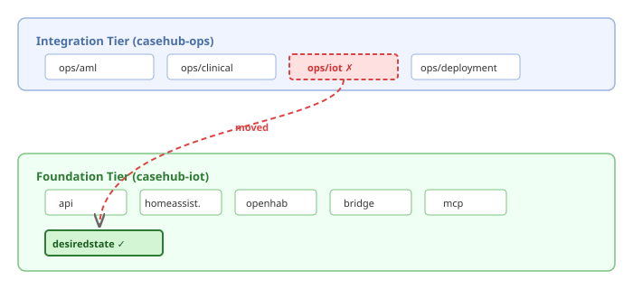
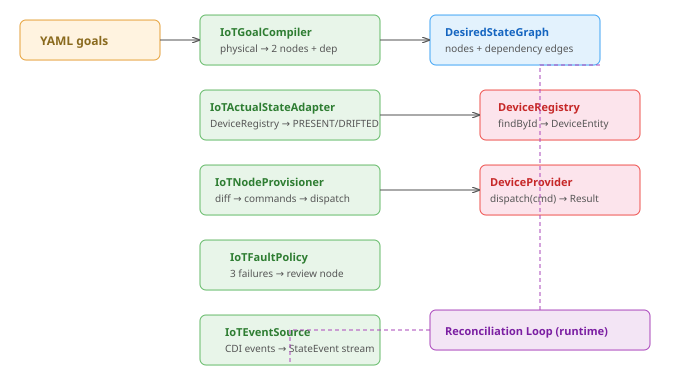

# The module that was in the wrong tier

IoT desired state lived in casehub-ops — the Integration tier. It compiled
against ops-api for approval infrastructure, depended on the ops deployment
model, and sat alongside modules that orchestrate clinical trials, AML
compliance, and enterprise case management. A module that talks to light
bulbs and thermostats, sitting next to one that evaluates anti-money
laundering risk.

The tier architecture exists for a reason. Foundation modules provide
domain-agnostic abstractions. Integration-tier modules wire those
abstractions into specific deployment contexts. IoT device operations —
compiling YAML goals into a desired state graph, comparing actual device
state to desired state, dispatching commands to converge — are Foundation
concerns. They don't need ops approval workflows. They don't need
WorkItem generation. They need `DeviceProvider.dispatch()` and
`DeviceRegistry.findById()`.

## The approval simplification

The ops implementation had around 100 lines of approval re-entry logic —
`handleProvisionReEntry`, `handleDeprovisionReEntry`, wrapping
`ApprovalEvaluator` and `PlanStore`. This was the ops way of gating
physical device operations behind human approval. Reasonable for an
enterprise deployment where changing a production device configuration
should go through a change management workflow.

But the desiredstate runtime already has this. `HumanGating` on
`DesiredNode` controls whether `provision()` can be called. `PendingApproval`
is a return type from the provisioner itself. The entire approval flow
exists natively — the ops layer was wrapping it with a second, heavier
mechanism that added ops-api as a compile dependency for infrastructure
the module didn't need.

Removing the approval wrapper simplified `IoTNodeProvisioner` from a class
with two re-entry handlers and an evaluator to a straightforward
provision-or-fail implementation. The provisioner receives a `DesiredNode`,
looks up the device in the registry, resolves the provider, normalises
capabilities, diffs desired against actual, maps the diff to device
commands, and dispatches. If any command fails, it returns `Failed`. If
all succeed, `Success`. No re-entry. No plan store. No approval evaluator.

## What the module actually does

The desiredstate module bridges the generic `casehub-desiredstate` runtime
to IoT device operations through five SPI implementations:

`IoTGoalCompiler` takes a YAML goal set and produces a `DesiredStateGraph`.
Each device goal with `physical: true` produces two nodes — a
`PhysicalDeviceSpec` with `HumanGating.ALL` (requires human approval
before creating a physical device) and a `DeviceConfigSpec` with
`HumanGating.NONE` (configuration changes are automatic), linked by a
dependency edge so config waits for the physical device to be approved.

`IoTActualStateAdapter` reads current device state from `DeviceRegistry`
and classifies each node: ABSENT if the device isn't in the registry,
PRESENT if capabilities match desired state, DRIFTED if any differ.
`CapabilityNormalizer` handles the comparison — temperatures become
`{value, unit}` maps, enums become name strings, numbers become stripped
`BigDecimal`. Without normalisation, `22` versus `22.0` versus
`BigDecimal("22")` produces false drift detections.

`IoTNodeProvisioner` is the execution point. When the reconciliation loop
detects a drifted node, it calls `provision()` with the desired state.
The provisioner resolves the device, resolves the provider, normalises
both sides, diffs, and dispatches commands for each divergent capability
via `CapabilityCommandMapper`. The mapper handles the standard vocabulary:
`isOn` → `turn_on`/`turn_off`, `targetTemperature` → `set_temperature`,
`isLocked` → `lock`/`unlock`, with a `set_<key>` fallback for unknown
capabilities.

`IoTFaultPolicy` uses the desiredstate runtime's `ThresholdFaultPolicy`:
after 3 consecutive `PROVISION_FAILED` faults on a device-config node, it
adds an `IoTReviewSpec` review node to the graph — human escalation.
The review node is a marker; the desiredstate runtime tracks its
completion via external signals.

`IoTEventSource` bridges CDI async events to the desiredstate runtime's
reactive event stream. `StateChangeEvent` (device discovered, went
offline, capabilities changed) maps to PRESENT/DRIFTED/UNKNOWN. Provider
disconnection emits UNKNOWN for all tracked devices.

## The cross-repo cleanup

The ops side was pure deletion — remove the `iot/` module directory,
remove the four spec types from `ops-api/iot/`, remove the
`<module>iot</module>` from the parent pom. No other ops module depended
on ops/iot, so the deletion was clean. One pom.xml conflict from a
whitespace change during rebase — resolved in thirty seconds.

Eleven test classes, eleven source files, all of it moved, adapted, and
verified. The integration test runs the full reconciliation loop against
`MockDeviceProvider` — compiles goals, reads actual state, detects drift,
dispatches commands, verifies convergence. The same test that validated
the code in ops now validates it in iot, without the approval
infrastructure it never needed.
