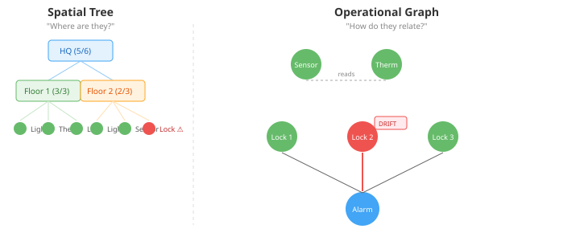
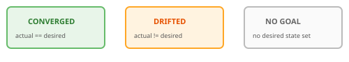

# Two views of the same devices

A device list answers "what devices exist and what's their state." Useful,
but it doesn't answer two other questions that matter when you're
operating a fleet: "where are they?" and "how do they relate to each
other?"

The first question is spatial. Devices live in locations — HQ, Floor 2,
Kitchen. The answer is a tree: a spatial hierarchy you can collapse and
expand, with aggregate health at each level. The second question is
operational. Devices have dependencies — the thermostat depends on the
temperature sensor, the alarm depends on all door locks being armed. The
answer is a graph: nodes are devices, edges are operational dependencies,
and colour tells you what's drifted from desired state.

These are fundamentally different visualisations, not tabs on the same
component. The tree is DOM — collapsible nested `
` elements
with aggregate badges at each level. The graph is a canvas with positioned
nodes and directed edges. They share data types but not rendering logic.

## Where the data comes from

The spatial tree comes from `DeviceEntity.location()`. OpenHAB populates
this from `thing.location()` — the convention is path-like segments:
`"HQ/Floor2/Kitchen"`. Home Assistant locations are null today (area
registry integration is pending). The parser splits on `/`, builds tree
nodes for each segment, and groups devices under their leaf location.
Devices with null location appear at the root as "Unassigned."

The operational graph comes from `DesiredStateGraph`. The desiredstate
module (just moved from ops — previous entry) models device dependencies
as directed edges: if `lock-front` must be locked before `alarm-1` can
arm, there's a `Dependency(alarm-config, lock-config)` edge. The graph
view extracts these edges and decorates each node with its drift status
relative to desired state.

This was a key design decision: derive edges from desired state
declarations rather than inventing a new edge declaration format. Strong
precedent from infrastructure-as-code tools — Terraform's dependency
graph, Microsoft Aspire's resource graph, LF-Edge EVE's depgraph all
derive dependencies from state declarations. Most IoT devices are
independent; edges only appear when operational dependencies exist. The
sparse graph is the expected case.

## Drift visualisation

Drift is the interesting layer. A device can be in one of three states
relative to its desired state goal:

`TopologyAssembler` joins `DeviceRegistry` data with the optional
`DesiredStateGraph` and `DriftPolicy`. When the desiredstate module is
present, each device gets a `DriftStatus` — CONVERGED, DRIFTED, or
NO_GOAL. When it's absent, everything is NO_GOAL. The drift computation
is the same normalised comparison that `IoTActualStateAdapter` uses:
`CapabilityNormalizer.normalize()` on both sides, then key-by-key
equality check.

Location aggregates roll up drift to each tree level. A location with
5 converged devices and 1 drifted device shows `5/6` in green-to-amber
as a visual cue that something needs attention without requiring you to
expand every branch.

## The TopologyApi

The backend follows the `@McpDomain` pattern established by the device
and simulation APIs — a REST endpoint with SSE streaming for live
updates. A single `/api/topology` endpoint returns the full topology
response: nodes enriched with drift status, location hierarchy for the
tree view, and dependency edges for the graph view. The desiredstate-api
dependency is `<optional>true</optional>` — the topology endpoint
activates only when the desiredstate module is on the classpath.

## Frontend components

The components live in `src/components/`, not `.casehub-packages/`.
The `.casehub-packages` directory is gitignored — it holds external
packages synced via Maven SNAPSHOT. Project-specific components go in
`src/components/`.

Model logic is extracted into pure-function modules with unit tests:
`topology-tree-model.ts` (10 tests) handles tree building and aggregate
formatting, `topology-graph-model.ts` (7 tests) handles graph view model
construction with drift decorations. Lit decorator tests don't work
reliably in this repo's vitest/jsdom setup — extracting model logic into
pure functions was the practical path to test coverage.

The tree component uses native DOM: collapsible `
` elements with
drift badges and aggregate summaries. The graph component positions nodes
and draws edges — drift colours the node fills, dependency directions
show the operational flow.

A new top-level Topology page sits alongside devices, cases, situations
in the webapp sidebar. The devices page answers "what exists and what's
its state." The topology page answers "where are they and how do they
relate." Different questions, different page.
