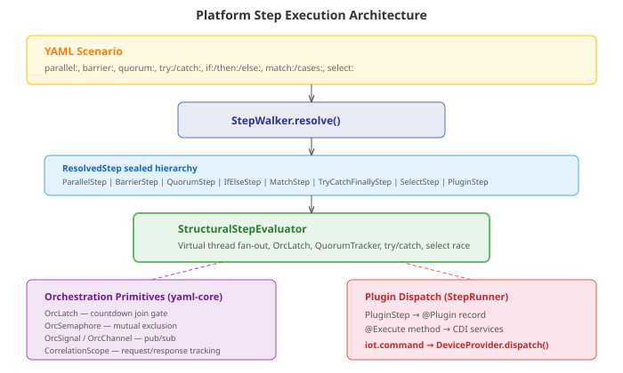
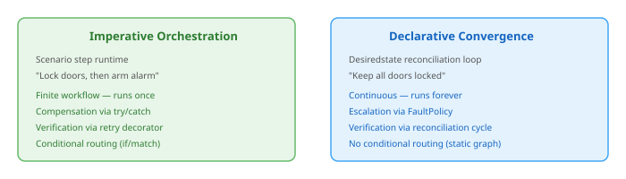
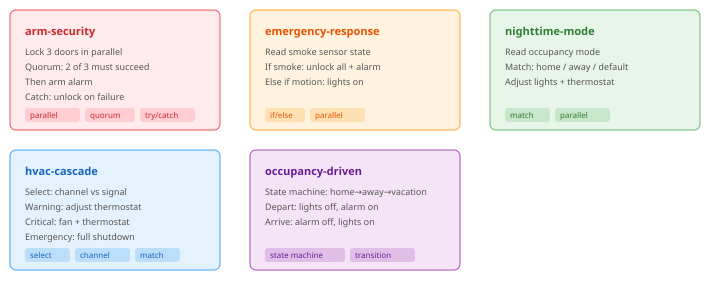

# The concurrency engine was already there

The issue description reads like a significant engineering project: map
scenario concurrency primitives — parallel branches, join gates,
conditional routing, temporal delays, compensating actions — to
distributed device command orchestration. Fan-out commands to multiple
devices, wait for confirmations, handle timeouts, coordinate dependent
actions. A distributed control problem.

The design started with exploration. Where do the concurrency primitives
live? What does the scenario runtime look like? What does the execution
model look like?

I found the scenario YAML files — `morning-routine.yaml`,
`emergency.yaml` — sequential sections with steps. No parallel branches
anywhere. The TypeScript code in `casehub-pages` had the full set:
`ParallelStep`, `BarrierStep`, `QuorumStep`, `IfElseStep`, `MatchStep`,
`TryCatchFinallyStep`, `SelectStep`. Rich orchestration primitives —
`OrcSemaphore`, `OrcLatch`, `OrcSignal`, `OrcChannel`,
`CorrelationScope`, `BlockingOrcStateMachine`. All in TypeScript. All
executing in the browser.

The server-side Java `ScenarioOrchestrator` dispatches steps sequentially.
No parallel fan-out. No join gates. The conclusion seemed clear: the
concurrency lives in TypeScript, the Java side is behind, and this issue
is about building the Java concurrency engine.

That conclusion was wrong.

## The correction

The TypeScript primitives are emulations. The real implementations are
in Java — in `casehub-platform/yaml-core`, a repo I hadn't searched.
Every TypeScript concurrency type has a Java counterpart, and the Java
versions are the source of truth.



`StructuralStepEvaluator` in `yaml-step-runtime` handles the full set:
`evaluateParallel()` spawns each child step on its own virtual thread
via `Executors.newVirtualThreadPerTaskExecutor()`, then `Future.get()`
to join. `evaluateBarrier()` uses `OrcLatch.await()` with optional
timeout. `evaluateQuorum()` pairs an `OrcLatch` with a `QuorumTracker`
that detects unreachability — when enough steps have failed that the
required count can never be reached, it releases the latch early and
reports the failure. `evaluateSelect()` races signal and channel
branches on virtual threads, cancelling losers when a winner emerges.
`evaluateTryCatchFinally()` provides the compensation path — the catch
block has access to `${result.step-name}` to inspect which steps
succeeded and dispatch compensating actions.

The whole thing is virtual-thread-native. No reactive wrappers, no
`Uni<>`, no event loops. Blocking calls on virtual threads. Exactly what
ADR-0005 prescribes.

The error was looking in `casehub-pages` instead of
`casehub-platform/yaml-core`. The pages backend `ScenarioOrchestrator`
is a demo/walkthrough dispatcher — it sends steps to browser clients for
UI interactions. The actual step execution engine lives in the platform.
The dependency chain was right there: pages depends on platform, the
IoT webapp imports from pages. Following the chain would have found the
Java primitives immediately.

## First-principles: imperative vs declarative

With the engine found, the real design question emerged: how should this
relate to the desiredstate module we'd just built?

Both operate on devices via `DeviceProvider`. Both handle concurrency —
desiredstate's `ParallelTransitionExecutor` fans out provisioning across
topological layers on virtual threads. Both handle failure — desiredstate
has `FaultPolicy` with threshold escalation.

The temptation was integration. An `iot.converge` step that submits a
`DesiredStateGraph` from within a scenario, waits for convergence,
bridges the two models. Elegant in theory.

First principles says otherwise. Every IoT device command is
fire-and-verify. `dispatch()` returning SENT means "the provider accepted
the command," not "the device changed state." A lock command might fail
physically — dead battery, mechanical jam. But this verification problem
has two fundamentally different solutions depending on what you're trying
to do:



If you need "lock all doors, wait, then arm alarm" as a one-shot
operation — that's a scenario workflow. If you need "keep all doors
locked at all times and correct drift automatically" — that's desired
state. They're complementary, not competing. Coupling them adds latency
(the reconciliation loop runs on 30-second resync intervals — too slow
for a workflow step) and complexity (the scenario module would depend on
desiredstate-api, pulling the entire graph/node/fault infrastructure
for what is often a simple command dispatch).

The decision: keep them independent. Both use `DeviceProvider` but don't
call each other.

## What got built

The design landed on a thin adapter. The platform has all the concurrency
machinery. The IoT repo needs two things: a way to dispatch device
commands from YAML steps, and a way to read device state in YAML
conditions.

### The plugins

`IoTCommandPlugin` is a `@Plugin`-annotated record — the platform's
annotation processor generates the `Action` wiring at compile time.
The `@Execute` method receives a `DeviceCommandDispatcher` CDI bean
(because `ServiceRegistry.lookup()` takes a raw `Class<?>` — you can't
inject parameterised types like `Instance<DeviceProvider>` through it).

```yaml
- step: lock-front
  iot.command:
    device: lock-front
    action: lock
```

`IoTStatePlugin` reads device state from `DeviceRegistry`:

```yaml
- step: check
  iot.state:
    device: sensor-smoke-1
```

Result accessible as `${result.check.capabilities.smokeDetected}`.

### The variable source

`IoTDeviceVariableSource` implements a new platform SPI —
`DomainVariableSource`. Domains register a prefix and a resolve function.
The IoT implementation registers `"device"` and resolves paths against
`DeviceRegistry`:

```yaml
- if: ${device.lock-front.capabilities.isLocked}
  then:
  - iot.command: { device: alarm-1, action: arm }
```

Live device state in any YAML condition. The `DomainVariableSource`
interface went into `yaml-plugin-api` (Tier 1, no CDI dependency) with
a `DomainVariableResolverEnricher` CDI bean in `yaml-step-runtime` that
discovers all sources and enriches the `VariableResolver`.

### The scenarios

Five orchestration scenarios exercise every concurrency primitive the
platform provides. Each one represents a real IoT use case:



`arm-security` is the most interesting. Parallel dispatch to three
locks, a quorum gate requiring 2 of 3 to succeed within 30 seconds,
then arm the alarm — wrapped in try/catch where the catch block checks
`${result.lock-front.result == 'SENT'}` to decide which locks to
compensate (unlock). If the alarm arm fails after 2 locks succeeded,
the catch unlocks only the locks that reported SENT.

## What this means for platform #486

The upstream platform issue asks for a generic command-dispatch SPI —
domains plug in actuator interfaces, the step runtime handles
orchestration. IoT is the first consumer. The pattern is clear: a
`@Plugin` record that takes domain-specific parameters and delegates to
a domain-specific dispatcher CDI bean. When a second domain appears
(services with HTTP/gRPC commands, workflow with human task dispatch),
the platform can extract the generic pattern from what IoT built. For
now, the IoT plugin is thin enough that extraction is mechanical.

The one platform change worth making immediately was
`DomainVariableSource` — every domain that adds scenario steps will need
its state readable in conditions. That SPI went into `yaml-plugin-api`
as a Tier 1 interface. IoT was the first consumer; it won't be the last.

## The lesson

The concurrency engine was already there. The issue that looked like
"build distributed command orchestration" turned out to be "write two
plugin records and five YAML files." The hard part was finding the
engine in the right repo — and the first-principles analysis that kept
the design from coupling two systems (scenarios and desiredstate) that
are better left independent.

Four source files, four test files, 22 tests, five YAML scenarios.
The platform did the heavy lifting years ago.
